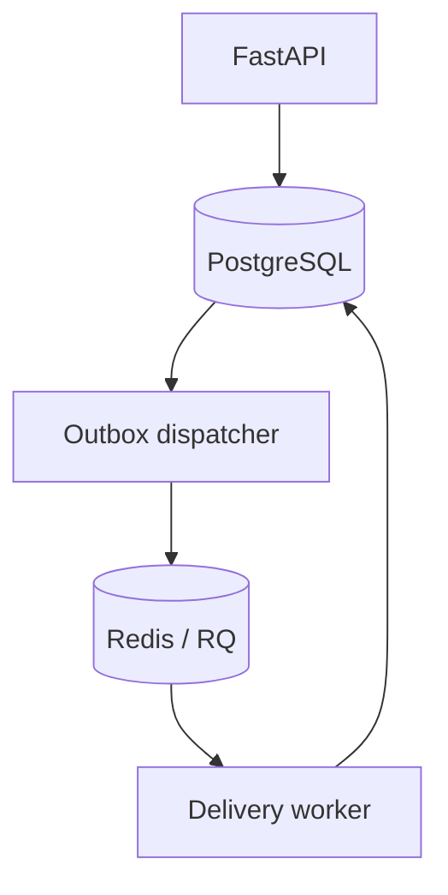

# Architecture and invariants

The application is a synchronous FastAPI service. SQLAlchemy sessions are scoped to requests or jobs. PostgreSQL owns transactional state; Redis transports work. A failed Redis enqueue cannot erase a committed booking or its notification intent.

## Ownership

Users can own businesses and also book services as customers. There is no client-supplied global owner role. Every management operation resolves the business owner through the professional. Customer booking access permits the customer or that business's owner. Waitlist entries and inbox notifications belong only to the customer. Private lookups return 404 when another user tries to access them.

Authentication uses Argon2 password hashes and short-lived HS256 JWTs (30 minutes by default). Every token references a server-side session, which makes logout immediate. Token issuer, audience, expiry and session state are checked. Register/login share a Redis-backed limit of 10 requests/minute per direct peer; forwarded headers are not trusted. This intentionally needs adjustment for a real trusted reverse proxy. API workers run with proxy-header handling disabled in the supplied container.

## Time and availability

Businesses have an IANA timezone. Appointments use timezone-aware input and UTC `timestamptz` storage. Working windows are local, weekly and may be split around lunch. Starts align to a 15-minute grid; durations are 15–240 minutes in 15-minute increments. Book between 15 minutes and 90 days ahead. Availability responses cover at most seven days, preloading calendar rows rather than querying for every candidate slot.

DST gaps are excluded through a timezone round trip. Both actual instants in a repeated hour can appear, with different UTC values. An appointment cannot cross local midnight or change its UTC offset during its duration. This is a deliberate policy limitation, not a claim that such appointments are impossible to support.

Availability is a public snapshot and does not reserve anything. The booking write rechecks availability under the calendar lock; a subsequent conflict returns 409. No customer identity is included in public slot responses.

## Booking transactions

All calendar mutations first lock the professional row. Booking changes then lock the booking row. Working-hours replacement and new time-off blocks use the same calendar lock, so they cannot race an API booking into an invalid schedule.

PostgreSQL also enforces two `EXCLUDE USING gist` constraints over `[starts_at, ends_at)`, filtered to confirmed bookings:

- No overlapping appointments for one professional.
- No overlapping appointments for one customer, including different businesses.

The half-open interval allows 10:00–11:00 followed by 11:00–12:00. These constraints protect overlap invariants even if an insert bypasses the domain service. Working-hour and block validation still belongs to the application; direct SQL is not an approved scheduling interface.

An appointment stores the service name, price and duration. Rescheduling preserves these terms. Service duration is immutable through the API; a different duration should be represented by a new service. Inactive services cannot receive new bookings. Existing bookings can still be cancelled or rescheduled using their agreed duration.

## Waitlist

Joining requires explicit acceptance of automatic booking and an occupied slot. Each entry stores the accepted price, name and duration. There is one intent per customer/service/start, including its terminal history; a cancelled entry cannot be rejoined in this version.

Cancelling or rescheduling checks waiting entries for the **exact former start time and professional**, ordered by creation time with an ID tiebreaker. It is not a flexible time-window matcher. Promotion uses current availability but the entry's agreed commercial terms. Disabled services and customers who have since booked elsewhere are skipped; those entries remain waiting and can be withdrawn. Old entries are not automatically purged.

Each candidate is attempted inside a savepoint. A customer overlap rolls back that candidate, not the cancellation. At most one entry is promoted per released start. The new booking, matched entry, history event and notification intents commit together. Cancelling the promoted booking can advance the next eligible entry. Removing a time-off block does not run waitlist matching.

## Outbox and delivery

1. Booking changes write outbox intents in the same SQL transaction.
2. The dispatcher polls every 30 seconds. It locks batches with `FOR UPDATE SKIP LOCKED`, enqueues RQ jobs and leases events for five minutes.
3. RQ retries failures up to three times with 10, 30 and 60 second intervals. The worker runs with its scheduler enabled.
4. A worker locks the booking **before** the event, matching the cancellation/rescheduling lock order. It skips cancelled, superseded or already-started appointments.
5. The inbox record and delivered state commit together. `notifications.event_id` is unique. Duplicate delivery attempts have one persistent effect.
6. If enqueue succeeds but SQL commit fails, or a job disappears, lease expiry permits redispatch. A poison event can be dispatched again after RQ exhausts its retries; production operation needs monitoring and an explicit dead-letter policy.

Reminders are due 24 hours before an appointment, or immediately when booked with less notice. Waitlist confirmations are immediately due. Rescheduling increments the booking version, skips pending old intents and writes a new reminder. Already-delivered inbox history remains visible.

This is **at-least-once dispatch with an idempotent database inbox**. It does not promise exactly-once external email/SMS delivery. No external provider is configured.

## Known operational limits

There is no outbox retention cleanup, user deletion, refresh-token flow, password reset, staff delegation or billing. Database backups, metrics/alerts and internet-scale abuse controls are deployment work. The Docker image includes test tooling for a simple reproducible portfolio workflow; a lean production image can split development dependencies later.
